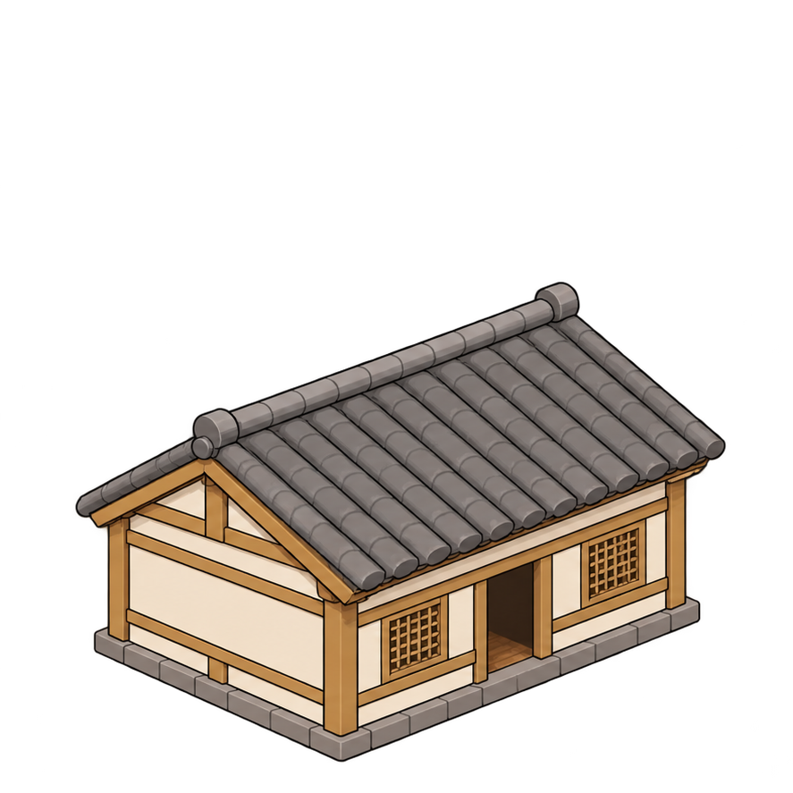

# 민가 1

밝은 목재와 밝은 벽체의 민가. 사용자가 선택한 깔끔한 일러스트풍 F 스타일이다.

- `민가_1.png`: 원본 아틀라스에서 해당 887×887 영역을 픽셀 변경 없이 추출한 투명 배경 그림.
- `규격.json`: 기존 시험의 배치·축척 참고값과 원본 출처. **규격은 수정 가능하며 최종 고정값이 아니다.**
- 현재 점유 후보: 5×6 논리칸, 타일 투영: 128×64픽셀. 지붕·처마의 그림 범위는 외벽 충돌과 별도로 다룬다.
- 피벗·문 기준점은 추출 이미지 내부 좌표이며 게임 월드 좌표가 아니다.

기존 독립 시험에서 색 블록 실내를 이용한 심리스 출입을 확인했다. 이 폴더의 그림은 외관 한 장이며 실내·분리 지붕 원화·실행 코드는 포함하지 않는다.

등록일: 2026-11-07. 이번 등록은 자료 정리이며 본게임 적용·새로운 동작 검증을 의미하지 않는다.
