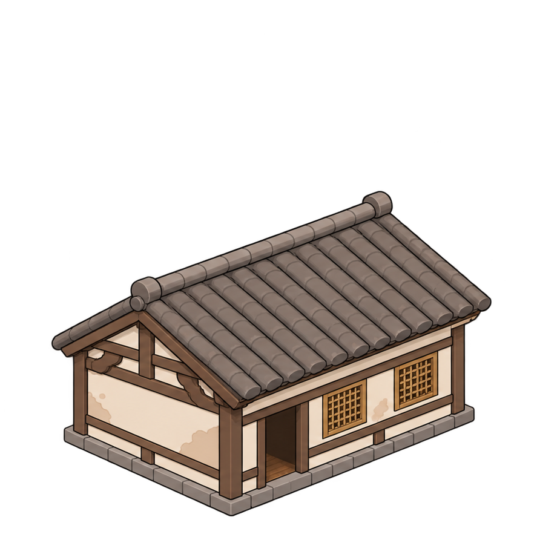

# 민가 2

짙은 목재와 벽체의 보수 흔적이 있는 민가. 사용자가 선택한 깔끔한 일러스트풍 F 스타일이다.

- `민가_2.png`: 원본 아틀라스에서 해당 887×887 영역을 픽셀 변경 없이 추출한 투명 배경 그림.
- `규격.json`: 기존 시험의 배치·축척 참고값과 원본 출처. **규격은 수정 가능하며 최종 고정값이 아니다.**
- 현재 점유 후보: 5×6 논리칸, 타일 투영: 128×64픽셀. 지붕·처마의 그림 범위는 외벽 충돌과 별도로 다룬다.
- 피벗·문 기준점은 추출 이미지 내부 좌표이며 게임 월드 좌표가 아니다.

기존 독립 시험에서는 외관·충돌만 연결했다. 실내와 심리스 출입은 연결하지 않았다.

등록일: 2026-11-07. 이번 등록은 자료 정리이며 본게임 적용·새로운 동작 검증을 의미하지 않는다.

## 뒷편 원화

- 파일: [민가_2_뒷편.png](%EB%AF%BC%EA%B0%80_2_%EB%92%B7%ED%8E%B8.png)
- 원본 반대쪽 후면 사선1방향을 새로 제작했다. 기존 정면 파일은 변경하지 않았다.
- 원화 캔버스1254×1254px. 정면 원화의 픽셀 피벗·표시 배율을 그대로 복사하지 말고, 같은 논리 점유와 시각적 크기에 맞춰 CLI에서 확인한다.
- 후문은 추가하지 않았다. 정문·출입 논리는 기존 정면에 유지하며 뒷벽에 새 출입을 만들지 않는다.
- 좌우반전 사용 시 부속 위치·충돌·사용면·출입 좌표를 같은 기준점에서 함께 변환하고, 글자/비대칭 구조와 실제 배치를 확인한다.

추가일:2026-11-08. 실제 게임 배치·방향 전환은 미검증이다.
